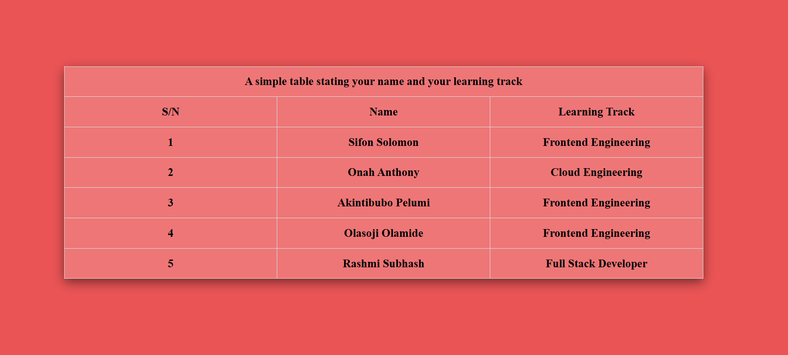

# 📊 Simple HTML & CSS Table Project

This project is a beginner-friendly **HTML & CSS webpage** that displays a styled table of contributors and their learning tracks.  
It is lightweight, responsive, and easy to extend with your own data.

---

## 🚀 Features
- Clean and minimal **HTML structure**
- Modern **CSS styling** with centered layout
- Easy to **add/edit contributors** in the table
- Fully customizable design (colors, font, shadows)
- Open-source and beginner-friendly

---

## 🖼️ Preview
> 
---

## 🛠️ Tech Stack
- **HTML5** – For structure  
- **CSS3** – For styling  

---

## 📂 Project Structure
```bash
├── index.html      # Main HTML file with the table
├── style.css       # Stylesheet for table & page
├── LICENSE         # Project license
└── README.md       # Documentation
```
## ⚙️ Setup & Usage

- Clone the repository

- git clone https://github.com/your-username/your-repo-name.git


- Open the project folder

- cd your-repo-name


- Open in browser

- Simply open index.html in your browser.

- You should see a styled table with sample contributor names.

## 👨‍💻 Contributing

We welcome contributions! 🎉

- Fork the repository

- Add your name and learning track in the table (inside index.html)

- Commit your changes

- Open a pull request

- ✅ Please ensure your entry follows the existing format.

## 📜 License

This project is licensed under the terms of the MIT License.

## 🌟 Acknowledgements

- Inspired by collaborative learning projects

- Built for practice in HTML & CSS fundamentals


---

Would you like me to also add **badges** (like GitHub stars, forks, license, last commit) at the top of the README for an even more polished, GitHub-ready look?